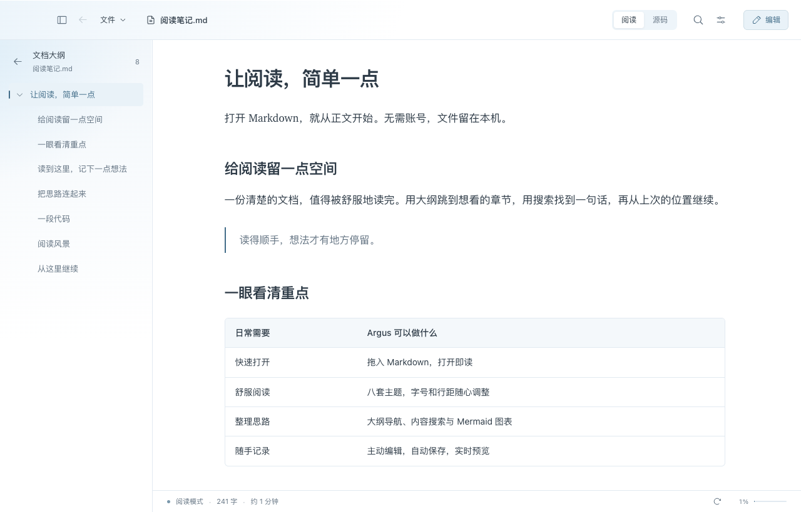
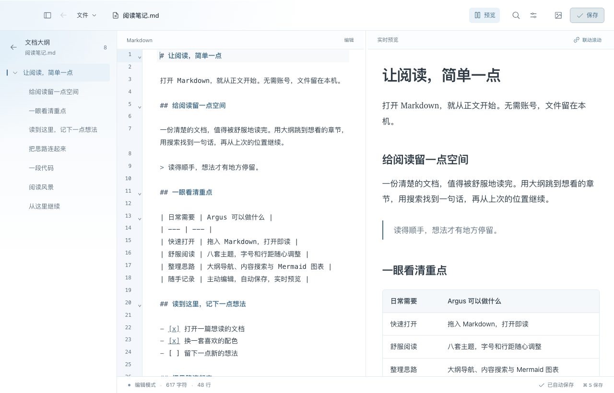

<div align="center">


# Argus

### 免费、轻量、好用的 Markdown 阅读器

为日常阅读 Markdown 而做，也能随手编辑。免费开源，无需账号，文件保存在本机。

[](https://github.com/wylycool/argus/releases/latest)
[](https://github.com/wylycool/argus/releases/latest)
[](LICENSE)
[](https://github.com/wylycool/argus/releases)
[](LICENSE)
[](https://github.com/wylycool/argus/actions/workflows/ci.yml)

[免费下载 macOS 版](https://github.com/wylycool/argus/releases/latest) · **当前安装包约 6 MB**

简体中文 | [English](docs/open-source/README.en.md) | [下载安装](https://github.com/wylycool/argus/releases/latest) | [使用指南](docs/open-source/user-guide.md)

</div>



## 为什么做 Argus

我试用过不少 Markdown 阅读软件，有些阅读体验不够顺手，有些基础功能需要付费。我想要的其实很简单：打开一份 `.md`，就能舒服地读下去。

所以我做了 Argus，并把它免费开源。它优先做好阅读：正文清楚、导航顺手、打开即读；需要修改时，再进入编辑。希望它也能成为你愿意留在电脑里的小工具。

## 读 Markdown，简单一点

- **免费使用**：没有订阅或付费解锁，源码以 MIT 许可证公开。
- **轻量安装**：0.10.0 的 macOS 安装包约 6 MB，使用系统 WebView，不内置 Chromium。
- **打开即读**：拖入 `.md` 就能阅读，通过大纲、搜索和阅读位置恢复继续上次进度。
- **按喜好阅读**：八套主题，可调整字号、行距与正文宽度；代码、表格和 Mermaid 图表都能显示。
- **文件在本机**：无需账号，不做云同步；需要时可编辑、自动保存或另存副本。

## 下载与安装

从 [GitHub Releases](https://github.com/wylycool/argus/releases/latest) 下载 `Argus_版本号_aarch64.dmg`，打开后把 Argus 拖入 Applications，再从“应用程序”启动。更新前先正常退出旧版。

| 系统                                         | 当前安装包     |
| -------------------------------------------- | -------------- |
| macOS 12 及以上，Apple Silicon（M 系列芯片） | `.dmg`         |
| Intel Mac、Windows、Linux                    | 暂未提供安装包 |

`Source code (zip)` 和 `Source code (tar.gz)` 是源码，不能直接安装。每次发布提供 `SHA256SUMS.txt`，可在下载目录校验：

```sh
shasum -a 256 -c SHA256SUMS.txt
```

当前安装包使用临时签名，尚未进行 Apple Developer ID 签名和公证。macOS 可能提示无法验证开发者；确认来自本仓库且校验通过后，按照“系统设置 → 隐私与安全性”的提示允许打开。

## 三步开始

1. 点击“文件 → 打开文档”，或把 Markdown 从 Finder 拖进窗口。支持一次打开多篇。
2. 通过左侧文件列表和大纲阅读；用 `⌘ F` 查找当前文档，`⌘ ⇧ F` 搜索已打开文档。
3. 点击“编辑”或按 `⌘ E` 开始修改，按需开启实时预览。输入自动保存；点击“保存”回到阅读。

## 阅读之外，也能随手编辑

| 功能       | 可以做什么                                                             |
| ---------- | ---------------------------------------------------------------------- |
| 阅读与排版 | Markdown、表格、任务列表、代码高亮、可折叠大纲、八套主题与字号行距调整 |
| 编辑与预览 | 撤销重做、实时分栏预览、双向滚动、窄窗口标签切换                       |
| 文件与草稿 | 新建文档、自动保存、本机未命名草稿、冲突提示、只读文件保护             |
| 图片与图表 | 插入或粘贴图片、图片放大、Mermaid 绘图与源码查看                       |
| 搜索与导航 | 文内查找、已打开文档内容搜索、快速切换、最近阅读和返回上一处           |
| 历史与导出 | 本地历史版本及差异、恢复版本、携带图片另存副本、系统打印与另存 PDF     |



截图使用当前版本界面与演示文档。完整用法、快捷键与容量限制见[使用指南](docs/open-source/user-guide.md)。

## 隐私与文件安全

- 文档、草稿、历史与偏好保存在本机；Argus 不提供文档上传、账号或云同步服务。
- 只管理主动打开的文件，不自动扫描同目录。关闭文档不会删除磁盘文件。
- 自动保存前校验磁盘版本；外部修改、只读或写入失败时保留输入并提示处理。
- Markdown 引用的远程图片会向图片地址发起请求；点击外部链接会交给系统浏览器。
- 单篇文档上限 16 MB；本地历史有容量上限，应另外备份重要文件。

安全边界与漏洞报告方式见 [SECURITY.md](SECURITY.md)。

## 从源码运行

需要 macOS、Node.js 24、Rust stable 和 Xcode Command Line Tools。

```sh
git clone https://github.com/wylycool/argus.git
cd argus
npm ci
npm run desktop
```

浏览器界面开发用 `npm run dev`；构建 Apple Silicon DMG 用 `npm run bundle`。开发结构、验证命令与提交约定见 [CONTRIBUTING.md](CONTRIBUTING.md)。

## 反馈与贡献

欢迎通过 [Issues](https://github.com/wylycool/argus/issues) 报告问题或提出建议，也欢迎提交 Pull Request。报告前请隐去私人路径、文档内容和图片中的敏感信息。

## License

Argus 使用 [MIT License](LICENSE)。Copyright © 2026 wylycool and contributors。第三方依赖保留各自许可证，详见[第三方说明](docs/open-source/third-party.md)。
