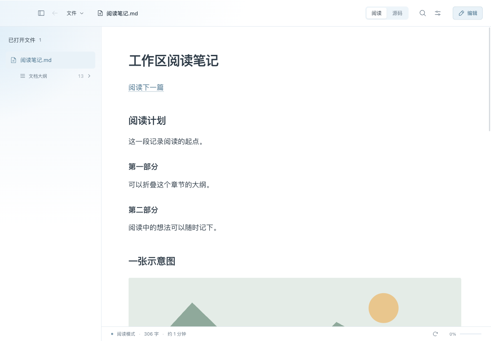
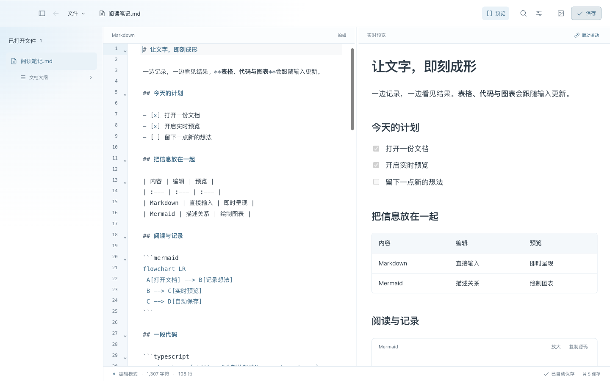

<div align="center">


# Argus

### A quiet place for Markdown

A lightweight macOS Markdown reader and editor. Read first, edit when needed, keep your files local.

[简体中文](../../README.md) | English | [Download](https://github.com/wylycool/argus/releases/latest)

</div>



## Download

Download the Apple Silicon `.dmg` from [GitHub Releases](https://github.com/wylycool/argus/releases/latest). Open it, drag Argus to Applications, and launch it from there. Requires macOS 12 or later. Intel Mac, Windows and Linux packages are not currently provided. The application interface is currently in Chinese.

The package is ad-hoc signed and has not been signed with Apple Developer ID or notarized. macOS may display a developer verification warning. Verify the download using the release's `SHA256SUMS.txt`, then follow the instructions in System Settings → Privacy & Security if necessary.

```sh
shasum -a 256 -c SHA256SUMS.txt
```

## Features

- Markdown reading with tables, task lists, syntax highlighting, an outline, eight themes and typography controls.
- CodeMirror editing with autosave, undo/redo, live preview, adjustable panes and synchronized scrolling.
- Local drafts, external-change detection, conflict protection and version history with diffs.
- Images, clipboard image insertion, Mermaid diagrams and image/diagram viewers.
- Find within a document, search open documents, quick switching and reading-position restoration.
- Save a copy with referenced local images, print and save to PDF through macOS.



Screenshots show demonstration documents. See the [Chinese user guide](user-guide.md) for detailed usage and limits.

## Privacy

No account or cloud synchronization. Documents, drafts, history and preferences stay on your computer. Argus only manages files you explicitly open. Remote images referenced in Markdown contact their source servers, and external links open in your system browser. Version history is bounded and does not replace independent backups.

See [SECURITY.md](../../SECURITY.md) for security boundaries and private vulnerability reporting.

## Development

Requires macOS, Node.js 24, Rust stable and Xcode Command Line Tools.

```sh
git clone https://github.com/wylycool/argus.git
cd argus
npm ci
npm run desktop
```

Use `npm run dev` for browser UI development and `npm run bundle` to build a DMG. See [CONTRIBUTING.md](../../CONTRIBUTING.md) for checks and project structure.

## License

[MIT](../../LICENSE). Copyright © 2026 wylycool and contributors. Third-party dependencies retain their own licenses; see [third-party notices](third-party.md).
